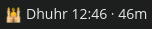
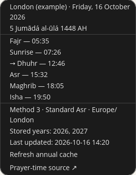

# CBar Prayer Times

See the next prayer, its time and a countdown in your COSMIC desktop's panel.
Click it to see today's timetable. Once the calendars are downloaded, the times
work without an internet connection.

This plugin needs Linux with **COSMIC**, **CBar** and **Python 3.10 or newer**.
It uses the AlAdhan service for prayer times; it does not calculate them itself.

## What it looks like

**Compact display**



**Click to open the timetable**



These are cropped screenshots of a separate **London (example)** preview, using
a fixed demonstration time. They do not show anyone's personal settings. Your
times will depend on your location, calculation method and the current date.

## Setup

### 1. Make sure CBar is installed

CBar is the small app that puts this plugin in the COSMIC panel.
If you do not have it yet, follow [CBar's official installation guide](https://github.com/alexandreprates/cbar#quick-install-on-pop_os).
You do not need to compile CBar from source.

### 2. Download and install this plugin

On this repository's GitHub page, click **Code → Download ZIP**. Extract the ZIP,
then open a terminal in the extracted folder, the one containing `README.md`.

Run:

```sh
bash scripts/install.sh
```

This installs only the prayer-time plugin and its panel entry. It does not
install CBar, replace your settings or restart the panel. No `sudo` is needed.

### 3. Set your location

In the same terminal, run this to create your settings file. If you already
have one, this command keeps it:

```sh
config_dir="${XDG_CONFIG_HOME:-$HOME/.config}/cbar-prayer-times"
mkdir -p "$config_dir"
if [ ! -e "$config_dir/config.json" ]; then
  cp examples/config.json "$config_dir/config.json"
fi
```

Open that `config.json` in a text editor. With COSMIC's text editor, you can use:

```sh
cosmic-edit "$config_dir/config.json"
```

The file starts with a **London example**. Change it to your own settings:

| Setting | What to enter |
| --- | --- |
| `label` | Your city name, shown in the popup |
| `latitude`, `longitude` | Your location's coordinates as numbers |
| `timezone` | Its timezone name, such as `Europe/London` |
| `method_id` | Your preferred [AlAdhan calculation method](https://aladhan.com/prayer-times-api) |
| `school_id` | `0` for standard Asr, or `1` for Hanafi Asr |

**Changing the city name alone does not change the times.** Set the coordinates
and timezone too. Keep JSON strings in double quotes and numbers without quotes.
Save the file when you are done.

The London example uses approximate coordinates `51.5`, `-0.1`, method `3`
(Muslim World League), standard Asr `0`, latitude adjustment `3` and midnight mode
`0`. These are demonstration choices, not a local mosque's timetable. See the
[full settings reference](docs/configuration.md) for the remaining fields.

### 4. Add it to the panel

1. Open **Settings → Desktop → Panel**.
2. Open **Configure panel applets**.
3. Choose **Add applet**, find **Prayer Time**, and add it.

**Prayer Time** is a panel applet, so it does not appear in the normal app
launcher. If you have several monitors, check the other panels too.

### 5. Check the times

Connect to the internet for the first download, then click the prayer display.
Check the location, calculation method and today's timetable. The popup should
list the current and following year under **Stored years**.

Compare the results with a trusted local timetable before relying on them.
Different calculation methods and local practices can give different times.

## Daily use

- The panel shows the next prayer and how long remains.
- Click it to see all of today's times.
- Normal updates read the saved calendars; they do not keep downloading them.
- **Refresh annual cache** downloads both years again. You should see
  **Refreshing prayer times…**, then **Prayer times updated**, or a failure message.
- **Last updated** shows when the current calendar was saved. Do Not Disturb can
  hide desktop banners, so this is another way to check an update.

No automatic adhan sound or prayer alarm is included.

## If something does not work

| Problem | What to check |
| --- | --- |
| **Prayer Time** is missing from the applet list | Close and reopen Settings. If it is still missing, save your work, log out and log back in. |
| You cannot see the display | Check the panel on each monitor. |
| **Prayer times unavailable** | Check that `config.json` is valid, all settings are filled in, and the first download has internet access. |
| The city name is right but the times are wrong | Check the coordinates, timezone, calculation method and Asr setting. |
| Refresh failed | Existing valid calendars are kept. Check your connection, then try **Refresh annual cache** again. |
| There was no desktop banner | Check Do Not Disturb and the popup's **Last updated** time. |

If a calendar is missing and a download fails, automatic retries wait 15 minutes.
Manual refresh can try again immediately. A saved year remains available offline.

## Remove it

First remove **Prayer Time** from the panel in Settings. Then, from this project
folder, run:

```sh
bash scripts/uninstall.sh
```

Your settings, downloaded calendars, CBar and other plugins are kept.

## Privacy

The London example is public demonstration data, not a user's configuration.
Screenshots are limited to the isolated demo and have no embedded text metadata.
Keep your real configuration, calendars, desktop captures and logs outside this
repository. Ignore rules help, but always review files before uploading them.

## More detail and development

See [configuration, storage and command-line options](docs/configuration.md).

Run the checks from the project folder:

```sh
bash -n scripts/install.sh scripts/uninstall.sh
python3 -B -X dev -W error::ResourceWarning -m unittest discover -s tests -v
```

GitHub Actions runs the tests on Ubuntu 24.04 with Python 3.10 and 3.12. Tests use
synthetic calendars and temporary folders, not personal settings or live API
requests. Real CBar panel, popup and manual-refresh behaviour has also been
checked on Pop!_OS/COSMIC; this does not guarantee every COSMIC/CBar version.

## Credits and license

- [CBar](https://github.com/alexandreprates/cbar), the COSMIC panel applet host.
- [AlAdhan Prayer Times API](https://aladhan.com/prayer-times-api) and its
  [credits, terms and accuracy warning](https://aladhan.com/credits-and-terms).

Licensed under **GPL-3.0-only**. See [LICENSE](LICENSE).
